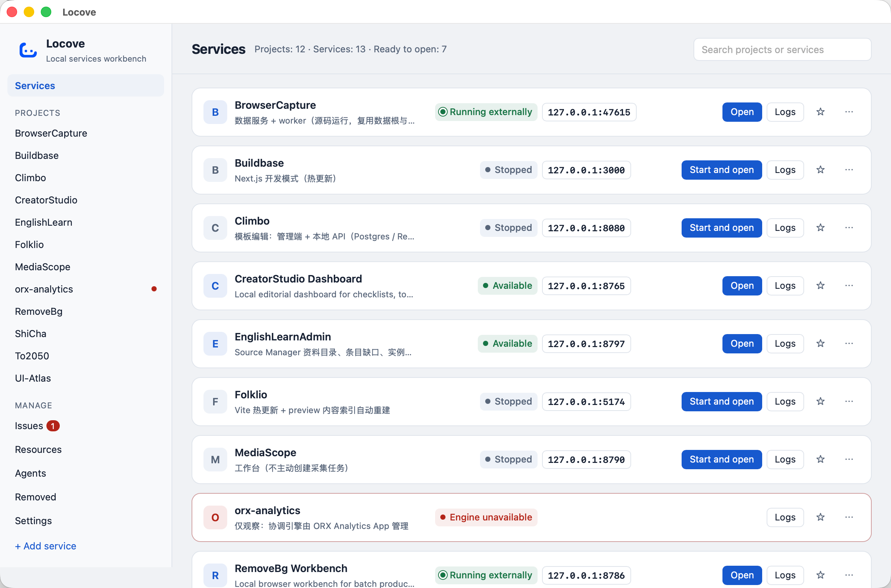
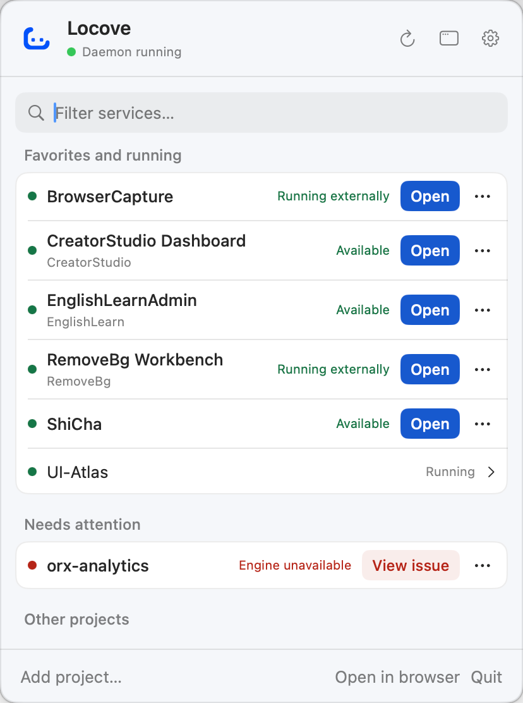

# Locove

**English** · [简体中文](README.zh-CN.md)

Locove is a macOS menu bar app and workbench for running local development services. Register a service once, then start it, open its URL, check logs, or diagnose a port conflict.

## Install

The **0.5.1 source preview** requires macOS 13 or later, the Xcode command-line tools, and Python 3.11 or later. The preview has been tested on Apple silicon. [Download the source archive and checksum](https://github.com/aderan/LocalServices/releases/tag/v0.5.1).

Extract the source to a directory you can keep. Open Terminal in that directory and run:

```sh
bash scripts/install.sh
```

The installer places the app at `~/Applications/Locove.app`. On a fresh install, the service list is empty and the interface defaults to English. In the workbench, choose **Settings → Interface language → 简体中文** to switch to Simplified Chinese.

## Workbench

Open the [local workbench](http://127.0.0.1:47800/) and choose **Add service**. Enter your project directory, then choose **Add manually** and fill in the start command and local port. Register the service and choose **Start and open**. Use **Issues** to see why a service failed.



## Menu bar

Click the Locove icon in the macOS menu bar to check service status or open a running service. Choose **Open in browser** to go to the workbench.



## Use your coding agent

The installer includes `lsctl`, Locove’s command-line client for scripts and coding agents, at `~/.local/bin/lsctl`.

Paste this into a local coding agent and provide the path to the extracted source:

> Check for the Xcode command-line tools and Python 3.11 or later. In the Locove source directory, run `bash scripts/install.sh` as my macOS user. Verify with `"$HOME/.local/bin/lsctl" status --json` and check that the menu bar icon appears.

To start a registered service, give the agent its name and ask it to run `"$HOME/.local/bin/lsctl" start <service-id> --open --wait 60`. The [registration format](skills/localservices/references/payload-format.md) covers new projects. Agent discovery is optional.

Locove keeps service definitions and edits in `~/Library/Application Support/LocalServices/`. Store credentials in private files referenced by `env_files`.

[Product scope](docs/SCOPE.md) · [Changelog](CHANGELOG.md) · [Installation, updates, and removal](docs/INSTALLATION.md) · [MIT license](LICENSE)
