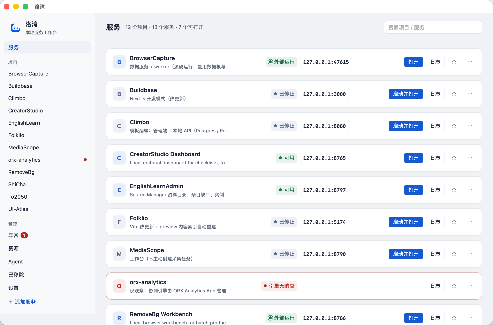
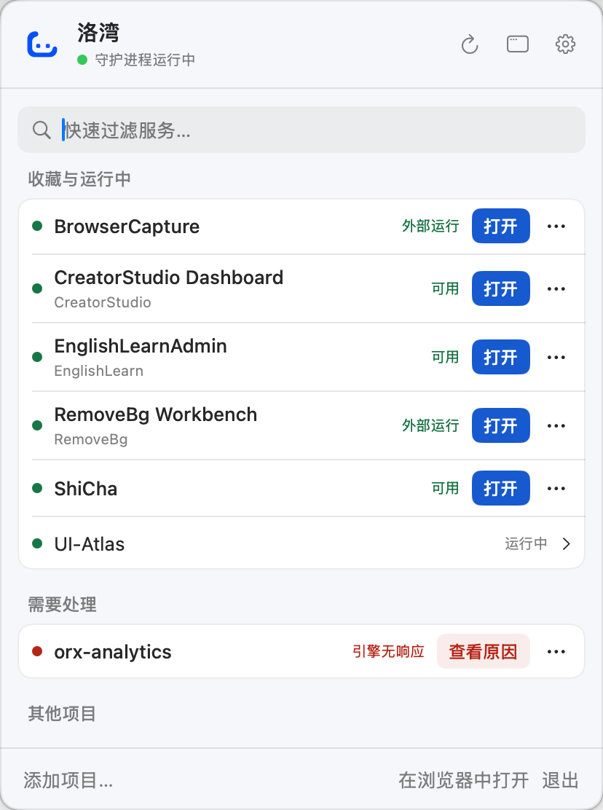

# Locove

Locove is a macOS menu bar app and workbench for running local development services. Register a project once, then start it, open its URL, check logs, or diagnose a port conflict. Coding agents can use the same controls through `lsctl`.

## Install

**0.1.0 source preview** requires macOS 13 or later, the Xcode command-line tools, and Python 3.11 or later. The preview has been tested on Apple silicon. A prebuilt DMG is planned.

Extract the source to a directory you can keep. Open Terminal in that directory and run:

```sh
bash scripts/install.sh
```

The installer places the app at `~/Applications/Locove.app`. Open Locove from the menu bar or visit the [local workbench](http://127.0.0.1:47800/). It starts in English with an empty service list. Choose **Settings → Interface language** to switch to Simplified Chinese.

Choose **Add service**, select your project directory, and enter its start command and local port. Then choose **Start and open**. Use **Issues** to see why a service failed.

## Use your coding agent

Paste this into a local coding agent and provide the path to the extracted source:

> Check for the Xcode command-line tools and Python 3.11 or later. In the Locove source directory, run `bash scripts/install.sh` as my macOS user. Verify with `"$HOME/.local/bin/lsctl" status --json` and check that the menu bar icon appears.

To start a registered service, give the agent its name and ask it to run `"$HOME/.local/bin/lsctl" start <service-id> --open --wait 60`. The [registration format](skills/localservices/references/payload-format.md) covers new projects. Agent discovery is optional.

Locove keeps service definitions and edits in `~/Library/Application Support/LocalServices/`. Store credentials in private files referenced by `env_files`.

## Screenshots

| English | Simplified Chinese |
| --- | --- |
|  |  |
|  |  |

[Product scope](docs/SCOPE.md) · [Release notes, updates, and removal](docs/RELEASE-0.1.0.md) · [MIT license](LICENSE)
