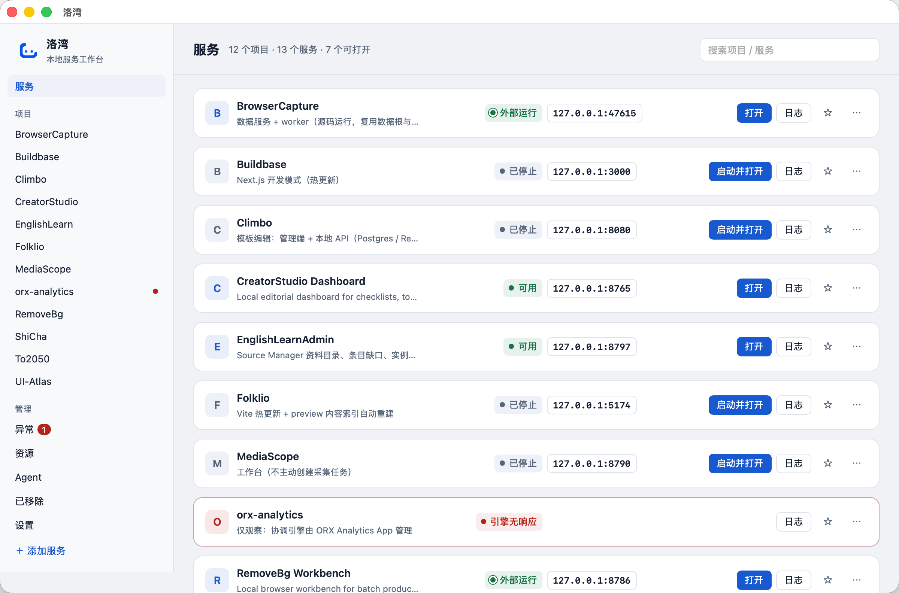
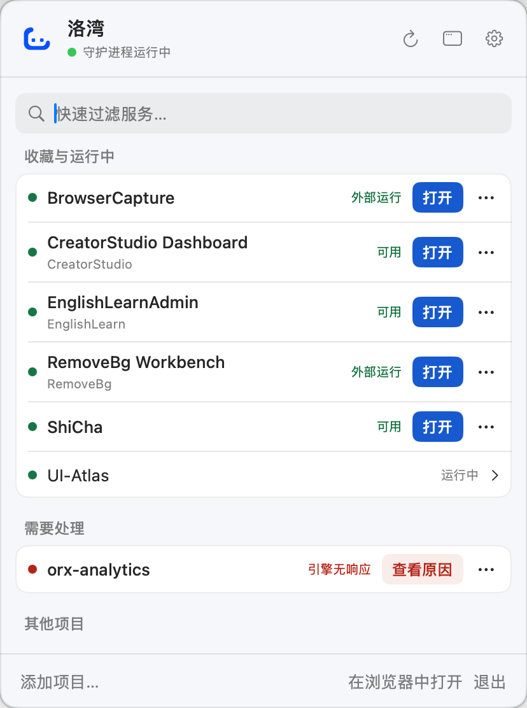

# Locove（洛湾）

[English](README.md) · **简体中文**

Locove 是一款用于运行本地开发服务的 macOS 菜单栏应用，配有本地工作台。登记服务后，你可以启动服务、打开访问地址、查看日志，也可以排查端口冲突。

## 安装

**0.5.1 源码预览版**需要 macOS 13 或更高版本、Xcode 命令行工具以及 Python 3.11 或更高版本。预览版已在 Apple 芯片的 Mac 上测试。[下载源码包与校验文件](https://github.com/aderan/LocalServices/releases/tag/v0.5.1)。

将源码解压到准备长期保留的目录，在终端中进入该目录并运行：

```sh
bash scripts/install.sh
```

安装器会将应用放到 `~/Applications/Locove.app`。首次安装后，服务列表为空，界面默认为英文。在工作台选择 **Settings → Interface language → 简体中文** 即可切换。

## 工作台

打开[本地工作台](http://127.0.0.1:47800/)，选择**添加服务**，输入项目目录后点击**跳过识别，手动添加服务**，填写启动命令和本地端口。注册后点击**启动并打开**。启动失败时，可以在**异常**页面查看原因。



## 菜单栏

点击 macOS 菜单栏里的洛湾图标，即可查看服务状态或打开正在运行的服务。点击**在浏览器中打开**可进入工作台。



## 使用编程 Agent

安装器会将 `lsctl` 安装到 `~/.local/bin/lsctl`。这是 Locove 提供给脚本和编程 Agent 使用的命令行工具。

将下面这段话发给本地编程 Agent，并提供源码解压后的路径：

> 请检查是否已安装 Xcode 命令行工具和 Python 3.11 或更高版本。在 Locove 源码目录下，以我当前的 macOS 用户身份运行 `bash scripts/install.sh`。运行 `"$HOME/.local/bin/lsctl" status --json` 验证安装，并检查菜单栏图标是否出现。

要启动已登记的服务，把服务名称告诉 Agent，让它运行 `"$HOME/.local/bin/lsctl" start <service-id> --open --wait 60`。要登记新项目，请参阅[登记数据格式](skills/localservices/references/payload-format.md)。也可以选择让 Agent 自动识别服务。

Locove 将服务定义及其修改保存在 `~/Library/Application Support/LocalServices/`。请将凭据保存在私有文件中，并通过 `env_files` 引用这些文件。

[产品范围](docs/SCOPE.md) · [版本更新记录（英文）](CHANGELOG.md) · [安装、更新与卸载](docs/INSTALLATION.md) · [MIT 许可证](LICENSE)
