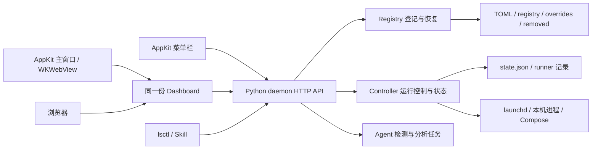
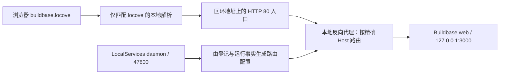

# LocalServices：架构、本地域名与 UI 改造评估

日期：2026-11-04。基于本仓当前源码、实际运行的 Dashboard、既有测试和开源项目一手资料。此次交付是分析，不改变服务登记、运行意图、系统网络或应用实现。

## 判断

现有 Python daemon + launchd + AppKit/WKWebView 的方向适合当前 macOS 本地服务工作台。已有运行意图、外部实例识别、忙碌保护、源码更新、移除恢复和共享容器保护，重写底座的回归成本明显高于界面重做。

建议保留底座，优先消除 Project/Service 语义重叠和 state 写入职责重叠；以独立的本地入口路由模块支持域名；用 Magpie 的紧凑行和 CC Switch 的管理界面组织方式改造 Web UI。达到参考产品的界面品质，不要求迁移到它们的桌面框架。

用户补充的硬要求：浏览器入口不出现端口，且使用产品专属后缀，例如 `buildbase.xxx`。建议新名称为 **Locove**（Local + Cove，本地服务的停靠湾；中文可称“洛湾”），入口示例 `http://buildbase.locove`。这是命名建议，尚未更名应用或仓库。

## 1. 当前实现与值得保留的设计



- UI 与 CLI 共用 daemon 和状态快照，退出 UI 不停服务，方向正确。
- 清单与运行意图区分，支持从真实源码目录启动；适配本地开发而非部署平台。
- 本地进程和 Compose 已真实存在，不是臆造扩展点，可以提炼运行适配接口。
- Docker context 显式、共享依赖保留、未知进程不强停、移除可恢复，都是需要保留的产品契约。
- Agent 只生成候选，注册另行校验并经过用户覆盖层；不应变成直接修改状态的第二个控制器。
- 同时有行为测试、真实 launchd 隔离测试和 GUI 验收证据，可用于渐进调整。

核心规模：`registry.py` 2,197 行，`controller.py` 1,559 行，`dashboard.html` 2,143 行。行数只是定位线索；真正的问题是职责和规则跨调用方泄漏。

## 2. 抽象尚不明确的地方

下表中“现状”是源码可确认的事实；“影响”包含设计推断，不等同于已经复现的故障。

| 优先级 | 抽象 | 现状与证据 | 建议及验收方向 |
|---|---|---|---|
| P1 | Project / Service / group | `manifest.Project` 表示服务，`Registry.projects` 表示多服务项目，`Controller.projects` 和 `/api/projects/<id>/start` 又使用服务 ID；批量操作仍使用旧 `group` | 代码内明确 `WorkspaceProject`、`ServiceDefinition`、`ComponentDefinition`。旧 URL/状态键/launchd label 用兼容层保留。项目成员集合与批量操作对象来自同一份定义 |
| P1 | 定义、意图、观测状态 | `Controller` 同时负责清单、端口归属、探针、构建安装、进程控制、更新、状态聚合和打开页面 | 区分定义、desired intent、observed runtime、operation。外部调用只需提交操作和读取快照，复杂决策留在生命周期模块内部 |
| P1 | 运行意图的唯一写入者 | `Store` 持有内存缓存并写 `state.json`；`Registry._set_state_intent` 在恢复后直接读改写同一文件，且未同步该 Store 内存 | daemon 内统一 IntentStore 写入口；恢复流程通过它设定意图。测试恢复与状态刷新/启停并发，不能由旧缓存覆盖另一项服务的变更。此处是结构性并发风险，本次未复现丢写 |
| P1 | 观察与执行 | `Store.intent()` 在读取时可能播种并保存缺省意图；`Controller._refresh()` 还会运行 `_tick_updates()`，触发更新调度 | 把刷新定义成采集与投影，把更新/生成器/重试统一放入调度流程。读取状态不写意图、不直接启动操作。保留现有轮询即可，不必先引入消息总线 |
| P1 | RuntimeAdapter 与项目特例 Adapter | `adapters.Adapter` 是 busy/health/observe/action 的项目钩子；Controller 内另有大量 `run == compose` 分支 | 两类职责命名清楚：运行方式处理启动/停止/观测/归属；项目策略处理业务忙碌与额外健康条件。先提炼真实 LocalProcess/Compose 差异，不造通用插件平台 |
| P1 | Endpoint / Route | `Project.open` 只有一个字符串；`Adapter.open_url()` 和 `_external_url()` 决定打开地址，后者通过字符串替换端口适配外部实例 | 域名配置引用服务组件，公开地址与上游监听地址分开。提供稳定 public URL、direct URL、route health，不再依赖字符串替换承载路由逻辑 |
| P2 | 操作模型与错误语义 | 分析任务有 job 文件；生命周期操作是 `ops/errors` 内存 dict，API 返回 accepted；部分判断依赖错误文本前缀 | 先统一 operation 的 id/kind/target/state/steps/error_code，分析与生命周期共享展示字段，执行器保持各自实现。错误码参与判断，中文 message 只用于展示 |
| P2 | Dependency / Resource / 权限 | 有 required/managed/container/volume/resource/provision；resource 注册时映射回 container 名称，容器启动权限散落在不同路径 | 将“引用哪个资源”“是否需要就绪”“允许恢复/创建/停止哪些对象”分别表达。避免一个 managed 布尔值暗示全部权限。当前只支持单选 Docker context，不急做多 context 平台 |
| P2 | 依赖顺序 | `Controller._order()` 忽略不存在的 after 引用；有环时直接追加剩余组件继续执行；项目间主要依赖 group_order | 注册和加载阶段明确拒绝未知引用与环，报告依赖链。先保证组件内 DAG，再在确有跨服务依赖时扩展；不是先接入通用工作流引擎 |
| P2 | 校验规则 | Agent `local_issues()` 明确独立实现注册规则子集；Registry 又维护字段白名单和校验；还有 JSON schemas | 提炼共享的路径/命令/端口/组件语义校验，分析使用只读候选模式，提交时再做最新状态下的 revision/冲突校验。候选校验通过不意味着自动获得执行权限 |
| P2 | 持久化事务 | `_atomic_commit()` 能处理进程内异常回滚，但多个 rename 之间没有持久化事务日志；恢复的 intent 写入在定义提交之后 | 明确“异常回滚”与“进程被杀后的恢复”是不同保证。先引入变更序号和恢复标记/启动校验；确有跨文件事务需求时再考虑 SQLite，保持 TOML 的可读定义价值 |
| P2 | 前端视图状态 | 一个 HTML 中混合 CSS、API、全局变量、向导、候选编辑和渲染；每 3 秒更新，`innerHTML` 整块替换，通过输入框/模态保护跳过重建 | 独立 API 客户端、服务端查询状态、用户编辑状态和展示组件。先阻止请求重叠、避免旧响应覆盖新响应；组件化后保留焦点、滚动和未提交输入 |

测试也应沿这些职责迁移。现有一部分 UI 测试依赖 HTML 文本和函数名，GUI 脚本用桩 DOM 执行整段内联 JS；它们证明不少现有逻辑，但不能代替真实浏览器/WKWebView 的交互验证。前端改造时保留登记、移除、恢复等行为断言，逐步替换结构锚点断言。

建议的模块接口关注四个真实任务：

1. **Catalog**：给定候选与 revision，返回校验/差异；确认后原子提交服务定义。
2. **Lifecycle**：给定服务和操作意图，串行完成准备、运行、就绪和失败收尾；通过真实 LocalProcess/Compose 适配。
3. **Observation**：采集运行事实并生成一致快照，返回观察时间、错误与新鲜度，不直接写运行意图。
4. **LocalRouting**：由已提交 Endpoint 和已验证 Runtime 生成路由，校验后激活，失败继续使用上次有效配置。

先建立职责，不要求一次性创建很多类。一个只转发调用的新类不能降低调用者认知成本。

## 3. 新名称与 `buildbase.locove` 无端口入口

### 命名建议

推荐 **Locove**：短、便于输入，既能表达本机工作上下文，也能承接“项目和服务集中停靠”的产品定位。统一使用 `buildbase.locove`、`shicha.locove`、`explore.locove`；备选 **DevPerch**（服务栖所），对应 `buildbase.devperch`。域名后缀为全局设置，服务域名前缀可单独修改，不直接从可变的项目显示名实时推导。

不采用 DevHarbor、LocalDeck 等候选：初步检索已存在高度相关的同类产品，分别见 [DevHarbor](https://devharbor.app/) 与 [Localdeck](https://www.localdeck.dev/)。Locove 只是本次命名建议，不表示已经取得公网顶级域或完成品牌注册。

产品名称与网络方案分别落地：先改变窗口/菜单栏/文案的显示名称，保留既有 state 位置、launchd label、服务 ID 与 `lsctl` 兼容入口，避免为了更名中断运行或丢失登记。

### 本机已经验证的范围

- macOS 26.6.2、普通用户 uid 501：`socket.getaddrinfo('buildbase.localhost', 3000)` 返回 `127.0.0.1` 和 `::1`。
- Codex 内置浏览器实际打开 `http://buildbase.localhost:3000/zh`，显示标题“总览 · Buildbase”及应用正文。
- 同一用户短暂 `bind(('127.0.0.1', 80))` / 443 均返回 `PermissionError [Errno 13]`；未 listen，随即关闭 socket。
- 未修改 hosts、DNS、PF、证书、launchd 或任何受管服务配置。

上述 `.localhost:3000` 测试仅验证了现有应用可接收新的 Host，不是用户要求的最终入口。最终验收必须是 `http://buildbase.locove`（或部署本地 HTTPS 后的 `https://buildbase.locove`），浏览器不带端口。HTTP 需要 80 入口，HTTPS 需要 443 与证书；首页成功也不证明 HMR、登录回调或其他浏览器已验收。

`.localhost` 是特殊用途名称，标准要求相应处理；不能从标准推出每个系统工具、每个浏览器版本都一定零配置可用。Microsoft 官方开发文档仍提示 Safari 的兼容差异。当前机器的系统解析成功也可能受已有解析配置影响，本次没有把成功归因于某一种系统默认。完整标准和浏览器资料见外部研究附件。

`.localhost` 指向访问者自己的机器；手机或另一台电脑使用同一 URL 不会自动访问这台 Mac。`.local` 则涉及 mDNS，不建议替代此次本地开发域名。

**自定义 `.locove` 与 `.localhost` 不同，必须由工具安装本地解析能力。** 推荐 macOS split DNS：安装 `/etc/resolver/locove`，只把 `.locove` 查询交给本机 DNS 模块；DNS 模块监听非特权高端口，解析到回环地址。系统 `man 5 resolver` 已核实支持独立 `port` 和按文件名匹配域；不用替换全局 DNS，也无需为了 DNS 再占用 53。

本地 DNS 与路由模块各有实际职责：DNS 解决名字到回环地址，代理根据精确 Host 找上游。DNS 只为已登记的名字回答回环地址，其余返回不存在；HTTP 代理也独立拒绝未知 Host。卸载撤销本工具自己的 resolver 和入口配置，并保留用户既有配置。

`/etc/hosts` 可用于少量服务原型，但不能表达通配，每次增删域名还需要改系统受管区块。作为长期工作台，split DNS 更适合一次安装后持续新增项目。

`.locove` 是本机私有命名约定，不是标准保留后缀；若未来要标准保留命名，可以选择 `buildbase.locove.test`，但它不符合用户偏好的两段短域名，因此仅作为备选，不替代主方案。[RFC 6761 的 `.test` 保留规则](https://www.rfc-editor.org/rfc/rfc6761.html#section-6.2)

### 建议实现



推荐先做 HTTP，通过成熟反向代理（优先评估 Caddy）承载数据流；Python 控制面生成和验证路由，不承担高并发长连接转发。Caddy 的反向代理已有 WebSocket/流式请求支持，能减少自行实现 HTTP 隧道的复杂度。

安装时解决一次低端口权限问题：可以评估独立、最小职责的特权监听器，或系统定向转发到非特权代理端口；实际安装机制需做专项验证。应用 daemon 仍以普通用户运行。特权程序不能接受任意 shell 命令或不受限的外部上游配置。配置/管理入口应受本地权限控制，代理只监听 loopback，不能因“域名方便”将服务暴露到局域网。

用户已明确拒绝带端口入口，所以高端口只能作为代理内部实现细节，不作为交付选项。内部继续使用 3000、517x 等上游端口，用户打开/复制/收藏的地址统一无端口。若 80 已由其他工具占用，报告冲突并提供可验证的接入或迁移路径，不静默退到带端口地址。

### 数据模型示意（提案，当前尚不支持）

```toml
[[endpoints]]
id = "web"
host = "buildbase.locove"
component = "web"
open_path = "/zh"
```

- `component` 决定真实上游；公开域名不用包含实际端口。代理匹配整个 Host，`open_path` 只是打开页面的落点，不应只代理 `/zh` 导致脚本/图片路径失效。
- 一个服务可有多个入口，如 `buildbase.locove`、`api.buildbase.locove`；仅后台任务或数据库不必有浏览器域名。
- 公开路由默认只分配显式登记的精确域名；重复域名在提交前拒绝，不使用“任意 hostname 自动转发”。
- 外部实例仅在已有归属与就绪校验通过后，路由到其实际端口；未知占用者不转发。
- 服务停止但登记仍在时，入口保留并返回明确的 unavailable 页面；移除登记撤销活动路由，恢复时重做域名冲突预检。
- 第一版不做“访问即启动”；该能力需要另外设计启动超时、并发请求合并、错误页与忙碌语义。
- 上游 ready probe 仍直接访问 IP:port，代理入口健康另行观测，避免把启动就绪检查绕进自身路由。
- `public_url`、`direct_url`、代理错误、最后成功配置序号进入快照，UI/CLI/Skill 共用；`open` 保留兼容。

### 必须覆盖的联动

1. 注册 schema、TOML 加载与输出、共享语义校验、人工覆盖、dry-run diff、定义导出、移除归档与恢复一起支持 endpoints。
2. 代理配置先校验再切换；错误配置不影响已生效路由，daemon 重启可重建路由。
3. WebSocket/HMR、SSE、长请求、上传体积、重定向、Host/X-Forwarded-* 和 IPv4/IPv6 均要验证。
4. 自定义 `.locove` 不属于 Vite 默认允许的 `.localhost`；按项目实际版本明确添加所需 Host，不要将 allowedHosts 改成 true。Next 按真实版本核对开发源与 HMR 配置。本机 Buildbase 使用 Next 15.5.24，不能直接套最新版文档的所有选项。
5. Buildbase `.env.example` 有 `NEXT_PUBLIC_SITE_URL=http://localhost:3000`，实际使用点和运行环境值需要单独审计；登录回调、绝对 URL、Cookie 域、CORS 和 OAuth 提供方允许列表也可能需要同步。当前域名访问成功不能覆盖这些验证。
6. UI 入口是 `127.0.0.1:47800`，daemon 对 Host/Origin 有精确检查，WKWebView 也只允许该 origin。业务域名第一版只代理业务服务，保留这个控制面 origin；不要为了业务域名放宽 token 或所有 `*.localhost` 控制权限。
7. HTTP 自定义域名不能直接继承 `.localhost` 的 secure-context 特例。若应用需要安全上下文、Secure Cookie 等，应增加无端口 HTTPS、本地 CA 信任与证书维护，不能因为最终 IP 是 loopback 就承诺这些浏览器能力。HTTPS 增量暂估 2–4 人日，另做证书信任、卸载、浏览器和登录回调验收。
8. Safari/Chrome/Firefox 的系统解析与安全 DNS/DoH、代理/VPN 环境须实际验证；`dig` 不一定使用 macOS 的系统 split DNS，验收以系统解析与真实浏览器请求为准。不能通过修改全局安全设置假装兼容性已解决。

## 4. CC Switch / Magpie：借鉴方向

用户已确认 Magpie 是 [yetone/magpie](https://github.com/yetone/magpie)。外部研究附件记录了本次查看的固定源码 SHA 与完整引用。

| 项目 | 已核实技术事实 | 对 LocalServices 的借鉴 |
|---|---|---|
| [CC Switch](https://github.com/farion1231/cc-switch) | Tauri 2 + Rust，React 18/TypeScript，Radix、Tailwind、TanStack Query；当前源码有 Sidebar。官方 README 的主截图仍体现较早的顶部切换/卡片布局，不能把它当当前全部界面 | 统一导航、主题 tokens、清晰当前状态、表单/弹层交互、列表操作组件化和异步查询管理 |
| [Magpie](https://github.com/yetone/magpie) | 当前为 Go + Wails v3 beta.24，嵌入 HTML/CSS/JS；有紧凑菜单栏面板和完整主窗口；官方 panel/agents 截图已实际查看 | 窄面板快速操作，完整窗口承接管理；整组紧凑行、主副文本、克制的中性色和对齐的行尾操作 |
| LocalServices | AppKit 菜单栏 + WKWebView 主窗口 + Python daemon，浏览器复用同页 | 这条路线本身就能实现两者的大部分交互品质；换桌面壳不会自动改善信息结构 |

两项目当前 LICENSE 均为 MIT。借鉴交互无需搬代码；实质复用代码/样式要保留相应许可声明。可继续使用自己的产品名称与图形资产。

### 当前界面观察

实际工作台在 1280×720 首屏大约展示 3–4 个项目；多数是一项目一服务，卡片标题和服务标题重复。每行有打开、停止、重启、日志、源码目录和更多菜单，控制权重接近。侧栏同时混放项目、异常、已移除、资源、Agent 和“设置 / 草稿”。常用地址藏在打开操作之后，没有作为主要信息呈现。

已有浅/深色 token、状态文字和颜色、键盘焦点样式、菜单/模态保护、全局搜索与断线时“未知”提示，值得继续使用并完善，而非全部抹掉。

### 推荐界面方向

Operate 模式：用户先判断哪些项目可用、打开所需工具、处理异常，再进入配置。

- **主窗口**：固定侧栏 + 紧凑服务列表 + 选中详情区域。单服务项目避免名称重复，多服务项目可以折叠分组。
- **服务行**：名称/用途、可点击可复制的 `buildbase.locove`、明确状态与归属、一个主操作和 `⋯`。运行中主操作“打开”，停止时“启动并打开”，异常时“查看原因”；日志保留稳定入口。
- **详情**：概览、入口、组件、依赖、日志、启动配置。端口、命令和证据属于诊断/配置层，减少首屏噪声。
- **信息架构**：服务、需要处理、共享资源、Agent 连接；项目作为收藏/分组上下文；草稿归到添加流程，已移除登记进入管理区，设置单独存在。
- **菜单栏**：先保留原生 NSMenu 以控制范围。若希望完整仿 Magpie 的视觉面板，再以 AppKit NSPopover + WKWebView 做可搜索、可打开、可启停的紧凑面板；配置仍进主窗口。
- **新增服务**：目录 → 识别 → 核对/差异 → 注册 → 启动验证；每一步区分分析成功、登记成功和运行成功，不能统一成“已完成”。
- **运行中反馈**：准备环境/安装/构建/就绪分步骤展示；控制面断联是“状态未知”，代理故障单独显示，不能把所有入口失败都标成服务停止。
- **交互门禁**：键盘导航、VoiceOver 可理解的状态、焦点恢复、长项目名/域名、多目录、空/失败/断线、轮询期间编辑和并发操作全部纳入验收。

### 技术路线和估算

以下是单名熟悉该仓库的开发者、工作日级别的工程工作量判断，包含相应范围内的回归验证，不是确定交付承诺；不包含跨平台和完整后端重写，各方案互斥，不能相加。

| 路线 | 范围 | 估算 | 判断 |
|---|---|---:|---|
| A：保留原生壳和原生 JS | 拆分静态模块、tokens、紧凑列表、操作收拢，保留当前大部分向导实现 | 3–5 人日 | 最快改善，复杂编辑和轮询状态的后续维护仍需继续处理 |
| B：保留原生壳，模块化重做 Web UI | API client / 查询状态 / 编辑状态 / views 分开，tokens、导航、详情、现有注册/恢复流程与回归测试 | 8–15 人日 | 推荐近期采用；可以保留现有 JS 技术，不需要为参考外观先引入新框架 |
| C：保留壳，迁移 React/TypeScript | Vite 静态构建、组件/表单/查询状态体系、原生桥、打包与测试迁移 | 12–20 人日 | 有持续复杂交互需求时值得选择；Node 仅作为构建依赖，运行时仍无需 Node |
| D：换到 Tauri/Wails 并重做 UI | 桌面桥、窗口、托盘、安装、sidecar/daemon、权限与生命周期、UI 全部重新集成 | 20–30+ 人日 | 当前缺少足以抵消迁移成本的收益；以后有明确跨平台目标再评估，launchd 本身仍需平台适配 |

推荐路线 B，但可以先以 A 的列表结构试验确定布局。若后续长期维护多个复杂编辑页面，再选择 C。React 是为复杂查询/编辑/组件复用服务，不是为了模仿 CC Switch 必须采用它。TanStack Query、Radix 等应按实际需求引入，不必整套照搬；运行时尽量保持当前轻量部署。

当前 daemon 只提供 HTML 与 API。若引入前端构建，需新增受控的静态 assets 路由、构建产物打包与缓存策略；HTML token 引导单独处理，静态资源不能包含令牌。还要保留 `lsbridge`、`lsOpenView` 等原生桥兼容，并调整现有提取内联 JS 的测试。

## 5. 落地顺序与成本

| 阶段 | 交付 | 验收标准 | 工作量估算 |
|---|---|---|---:|
| 1：澄清核心职责 | Project/Service 命名兼容层；意图统一写入口；共享基础校验；读取与调度职责收拢 | 既有定义、状态键、launchd label 不变；并发恢复/刷新/启停不丢意图；依赖环明确失败 | 3–5 人日 |
| 2：专属后缀与免端口 | Endpoint 模型、split DNS、本地 HTTP 代理、低端口安装方案、精确域名冲突校验、打开入口统一 | `http://buildbase.locove` 免端口打开，Next/Vite HMR 可用；外部实例实际端口、代理重载失败、重启、移除恢复、卸载均验收 | 5–9 人日 |
| 3：UI 路线 B 与产品名称 | Locove 显示名、紧凑服务列表、域名入口、详情、导航与新增/编辑/恢复流程组件化 | Chrome/Safari/WKWebView 的目标环境验证；键盘/断线/长内容/编辑中刷新通过；原有保护语义无回归 | 8–15 人日 |

合计约 16–29 人日，按一名开发者约 3–6 周工程量估算；阶段之间可在清晰接口后交错，但共享模型和 API 变更会制约并行收益。若加入本地 HTTPS 再预留 2–4 人日。只做列表视觉调整会更短，不能代表完整功能完成；带端口域名不计入满足用户需求的交付。

HTTPS、本地证书信任、访问即启动、跨平台、资源多 context 和数据库迁移都应独立定范围；当前三个目标不要求同时交付这些能力。

## 6. 本次验证与局限

- 已只读查看运行中的 LocalServices Dashboard，实际捕获并检查布局。
- 已在内置浏览器加载 Buildbase 的带端口子域名，未将此等同于免端口/跨浏览器/登录/HMR 验收。
- 已以普通用户验证本机解析与低端口 bind 权限；没有安装代理或配置系统网络。
- 先执行六组架构相关测试：**62 passed, 4 subtests passed**；随后执行 `python3 -m pytest tests/ -q` 全量回归：**436 passed, 14 subtests passed**，用时 133.77 秒。
- 没有修改应用代码，所以没有新增行为测试或执行应用构建；上面的并发风险、崩溃恢复和依赖配置问题需要在实施阶段先写针对性行为测试。

## 7. 代码和外部证据入口

- [领域清单](../localservices/manifest.py)：Project/Component/Dependency，open 和端口定义。
- [运行控制](../localservices/controller.py)：Store、_order、_external_url、group_action、project_status、_refresh。
- [登记与恢复](../localservices/registry.py)：_atomic_commit、_set_state_intent、restore_service、restore_project、注册校验。
- [控制面入口](../localservices/daemon.py)：Host/Origin/token、Dashboard 提供与定时循环。
- [工作台](../localservices/web/dashboard.html)：视图、轮询、模态和候选审核。
- [原生窗口](../menubar/MainWindow.swift)：WKWebView、受信 origin、原生桥。
- [Agent 校验](../localservices/agents/invoke.py)：local_issues 与 schema 校验。
- [Buildbase 清单](../services/buildbase.toml)：当前端口、打开地址、就绪探针与 Next dev 命令。
- [现有接口契约](CONTRACTS.md)：既有产品语义，后续实现需要更新契约并保留兼容。
- [一手资料研究及固定版本引用](research/2026-11-04-local-domains-ui-references.md)。
